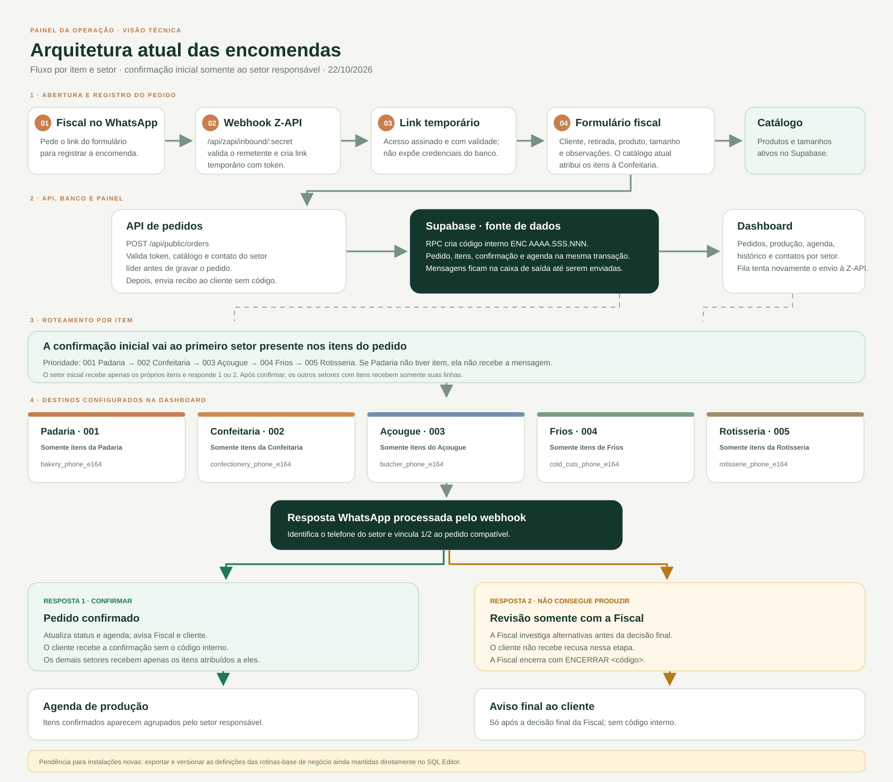

# Dashboard de encomendas

Dashboard e backend em código para pedidos, agenda de produção e notificações por WhatsApp. A aplicação usa Vercel para servir a interface e a API, Supabase para dados e Z-API para mensagens. O runtime não depende de n8n, Docker ou túnel Cloudflare.

## Funcionalidades

- Consulta de pedidos e histórico pela view `public.dashboard_orders`.
- Cadastro de um contato de WhatsApp por setor: Padaria, Confeitaria, Açougue, Frios e Rotisseria, além da Fiscal e do cliente.
- Criação de pedidos pela dashboard ou pelo formulário público da fiscal, atribuindo cada item ao seu setor.
- Revisão de impedimentos de qualquer setor pela fiscal sem encerrar o pedido; após a análise, a equipe responsável atualiza a encomenda pelo painel.
- Encaminhamento de itens e resumos separados para cada setor; cada equipe recebe somente os itens atribuídos a ela.
- Cada pedido pode envolver um ou mais dos cinco setores; o painel mostra apenas as áreas com itens no pedido.
- Registro de problemas de produção, conclusão de todos os setores e confirmação da retirada por eventos idempotentes.
- Avisos de WhatsApp registrados primeiro numa caixa de saída persistente e enviados pela Vercel Queue, com novas tentativas e chave de deduplicação.
- Webhook de entrada da Z-API: a fiscal recebe o link do formulário. O primeiro setor presente nos itens recebe a confirmação inicial; `1` confirma e `2` avisa somente a fiscal para investigar. Após a confirmação, os demais setores com itens recebem apenas suas linhas. O cliente só é informado da recusa após a análise final da fiscal, registrada com `ENCERRAR <código>`.
- Pesquisa de satisfação enviada duas horas após a retirada, com link assinado.
- Resumo de produção diário às 06:00 no horário de São Paulo.
- Limites de tentativas por origem para autenticação, formulário público, pesquisa e callback da Z-API. Os identificadores armazenados no Supabase são HMACs, não endereços IP.
- Portal opcional e independente para contas por setor, cadastro próprio de encomendas, produção e revisão da Fiscal. Usa tabelas próprias e não sincroniza pedidos nem aciona dashboard ou WhatsApp.

As regras transacionais de pedidos são funções PostgreSQL chamadas pela API: `dashboard_process_event`, `dashboard_upsert_production_agenda` e `dashboard_order_readiness`. A confirmação e a gravação da agenda passam pela mesma transação. A pesquisa usa o Vercel Workflow SDK; os avisos usam a Vercel Queue e ficam na caixa de saída do Supabase até a entrega.



## Desenvolvimento local

1. Instale Node.js 24 ou mais recente.
2. Copie `.env.example` para `.env.local` e preencha as credenciais localmente.
3. Execute:

   ```powershell
   npm install
   npm run dev
   ```

4. Abra <http://127.0.0.1:8766>.

No primeiro acesso, informe a credencial configurada como `DASHBOARD_ACCESS_TOKEN`. O servidor troca essa credencial por um cookie assinado, `HttpOnly`, `SameSite=Strict` e válido por até 30 dias. Enquanto a dashboard é usada, a validade é renovada automaticamente. A credencial não é guardada no armazenamento do browser. Sessões antigas salvas em `sessionStorage` são migradas uma vez e removidas.

O `.env.local` é ignorado pelo Git intencionalmente: ele contém credenciais e é carregado somente durante o desenvolvimento local. O `.env.example` contém nomes e valores de exemplo, sem chaves reais. A Vercel recebe as variáveis separadamente nas configurações do projeto. `APP_BASE_URL` pode ficar vazio no computador local; no ambiente publicado, informe o domínio HTTPS da produção para gerar links e callbacks públicos.

## Estrutura do projeto

```text
src/
  dashboard/  Inicialização da interface e estilos da operação
    domain/    Normalização e regras de domínio dos pedidos
    ui/        Renderização da lista e da agenda
  forms/      Estilos compartilhados dos formulários públicos
  orders/     Envio do formulário de encomendas
  shared/     Base visual e controles compartilhados
  surveys/    Envio das avaliações
api/          Handlers HTTP usados pelo servidor e pelas rotas Nitro
routes/       Adaptadores de entrada Nitro para os handlers de api/
lib/          Integrações, validação, sessão e acesso ao Supabase/Z-API
workflows/    Tarefas duráveis de satisfação
supabase/     Migrações e consultas operacionais
scripts/      Preparação dos arquivos públicos gerados no build
```

As páginas HTML na raiz são entradas multipágina do Vite. O conteúdo de `public/` é gerado durante o build e fica fora do Git; edite os arquivos fonte em `src/` e as páginas da raiz.

## Supabase

Antes do deploy, abra o **SQL Editor** do projeto Supabase usado pela aplicação e execute, em ordem, as migrações necessárias que ainda não foram aplicadas: `20261019000000_dashboard_runtime.sql`, `20261020104015_add_department_workflow.sql`, `20261020112117_fix_dashboard_phone_normalization.sql`, `20261020134546_add_confeitaria_sector.sql`, `20261021084158_normalize_product_size_selection.sql`, `20261021120905_add_sequential_order_codes.sql`, `20261021134036_add_confectionery_rotisserie_contacts.sql`, `20261021140729_enable_review_history_reads.sql`, `20261022011733_dashboard_clear_all_orders.sql` e `20261022103016_atomic_order_event_and_agenda.sql`. A última migração exige as assinaturas atuais de `dashboard_process_event`, `dashboard_upsert_production_agenda` e `dashboard_create_order_with_code`. Use `supabase/sql-editor/verify_atomic_order_and_outbox.sql` depois para conferir as assinaturas, permissões e fila.

`dashboard_clear_all_orders()` é chamado somente pelo botão explícito da dashboard. A migração de limpeza não deve apagar pedidos automaticamente ao ser aplicada ou reaplicada.

As definições atuais das rotinas-base de negócio foram criadas diretamente no SQL Editor e ainda não estão todas guardadas como migrações neste repositório. Para tornar um projeto novo totalmente reproduzível, rode `supabase/sql-editor/export_business_routines.sql` e salve as definições retornadas numa migração-base versionada antes de depender de uma instalação do zero.

### Tela inicial e ambientes

`/` abre a tela para escolher o fluxo. A dashboard existente continua disponível em `/dashboard.html`; a equipe do portal independente entra por `/setor.html`, e a gerência acessa criação de contas e pedidos em `/contas-setores.html`. A gestão exige uma conta de gerente do portal; não há cadastro público de contas administrativas.

### Portal independente por setor (opcional)

`/setor.html` é a entrada da equipe e `/contas-setores.html` é a área de gerência. O portal usa contas individuais do Supabase Auth, sessão `HttpOnly` própria e tabelas com prefixo `sector_portal_`. Pedidos, itens, setores, andamento e análises da Fiscal ficam nesses registros próprios. Nenhuma operação do portal consulta ou altera os pedidos, a agenda, as funções, as notificações ou o fluxo de WhatsApp da dashboard existente.

Para instalar, execute somente `supabase/sql-editor/create_sector_portal.sql` no SQL Editor. A migração `20261022144509_create_standalone_sector_portal.sql` contém a mesma estrutura para instalações que usam a CLI; não aplique as duas formas em sequência. O script cria os cinco setores iniciais e funções transacionais próprias, protegidas por RLS e disponíveis apenas ao backend. Não remove nem reescreve dados existentes.

Configure `SUPABASE_PUBLISHABLE_KEY` (também aceita `SUPABASE_PUBLIC_KEY` ou o nome legado `SUPABASE_ANON_KEY`), `SECTOR_SESSION_SECRET` e `SECTOR_MANAGER_BOOTSTRAP_TOKEN`. Gere valores aleatórios independentes de pelo menos 32 caracteres para os dois segredos. Mantenha o token de configuração privado: ele só serve para criar a primeira conta de gerência. Defina `SECTOR_PORTAL_ENABLED=true` somente depois de aplicar a migração do portal. No desenvolvimento local, use `.env.local`; na Vercel, configure as variáveis server-side no projeto.

Depois abra `/contas-setores.html`. Enquanto não existir uma conta de gerência, a página mostra **Criar o primeiro acesso da gerência**. Informe o token, nome, e-mail e escolha uma senha com pelo menos 12 caracteres. O sistema cria o usuário no Supabase Auth e o vincula à função de gerente do portal. Depois da criação, o formulário de primeiro acesso desaparece; a gerência pode cadastrar as contas da Fiscal e dos setores na mesma página. Não existe conta ou senha padrão.

A primeira conta só pode ser criada depois que as tabelas do portal existirem e o portal estiver habilitado. Se a página disser que o acesso por contas está desativado, aplique primeiro `supabase/sql-editor/create_sector_portal.sql` no projeto Supabase configurado para este ambiente, configure as variáveis acima e reinicie ou publique o aplicativo. Essa migração cria apenas as tabelas `sector_portal_*` e não altera os dados da dashboard ou do WhatsApp.

A gerência entra em `/contas-setores.html`, cria contas de setor/Fiscal e registra as encomendas independentes. O primeiro setor escolhido nos itens confirma a encomenda; os demais setores só recebem seus próprios itens dentro do portal. A equipe confirma, inicia e conclui a produção; pedidos com impedimentos vão à fila da Fiscal. A decisão final é registrada no portal e não envia mensagem automática ao cliente. `SECTOR_PORTAL_ENABLED=false` mantém o portal desligado; ativá-lo não muda o fluxo antigo da dashboard nem do WhatsApp.

A migração cria e restringe:

- `public.dashboard_operation_settings`, que guarda os telefones dos cinco setores, da Fiscal e o telefone padrão do cliente.
- `public.dashboard_automation_runs`, que protege resumos e pesquisas agendadas contra duplicidade.
- `public.dashboard_whatsapp_outbox`, que guarda mensagens de saída, tentativas, erros e estado de entrega.
- `public.dashboard_automation_audit`, preservando os registros antigos de auditoria quando a tabela existe.
- `public.claim_dashboard_automation`, uma função de uso interno para reclamar cada tarefa uma única vez.
- Um schema privado para contadores de limitação de tentativas, acessível somente pelo backend.
- RLS e grants de servidor nas tabelas operacionais, e uma view `dashboard_orders` com `security_invoker` sem acesso direto a usuários públicos.
- Execução das RPCs de operação limitada ao papel `service_role`.

A API precisa que o papel `service_role` tenha acesso à view `public.dashboard_orders`, às tabelas operacionais e às RPCs `dashboard_process_event`, `dashboard_upsert_production_agenda`, `dashboard_order_readiness`, `claim_dashboard_automation` e `consume_dashboard_rate_limit`. A chave `SUPABASE_SERVICE_ROLE_KEY` só é usada no servidor; não a coloque em `config.js` nem em variável com prefixo `VITE_`.

## Variáveis de ambiente

Configure em **Vercel → Project → Settings → Environment Variables** para Production e Preview. Para desenvolvimento local, use `.env.local`.

| Variável | Uso |
| --- | --- |
| `SUPABASE_URL` | URL do projeto Supabase |
| `SUPABASE_SERVICE_ROLE_KEY` | Chave de serviço, somente server-side |
| `SUPABASE_PUBLISHABLE_KEY` | Chave do Auth do portal; aceita também `SUPABASE_PUBLIC_KEY` ou `SUPABASE_ANON_KEY` |
| `SECTOR_SESSION_SECRET` | Assinatura de sessões do portal; mínimo de 32 caracteres |
| `SECTOR_MANAGER_BOOTSTRAP_TOKEN` | Token de uso único para criar a primeira conta de gerência; mínimo de 32 caracteres |
| `SECTOR_PORTAL_ENABLED` | Ativa o portal após aplicar a migração; use `true` |
| `DASHBOARD_ACCESS_TOKEN` | Credencial usada no primeiro acesso à dashboard; mínimo de 32 caracteres |
| `APP_BASE_URL` | Domínio público da dashboard, sem `/` no fim |
| `ZAPI_INSTANCE_ID` | ID da instância Z-API |
| `ZAPI_INSTANCE_TOKEN` | Token da instância Z-API |
| `ZAPI_CLIENT_TOKEN` | Token de segurança da conta Z-API |
| `ZAPI_WEBHOOK_SECRET` | Segredo usado no caminho de callback da Z-API |
| `PUBLIC_ORDER_FORM_TOKEN` | Segredo do link público enviado à fiscal |
| `SURVEY_SIGNING_SECRET` | Segredo para assinar os links de avaliação |
| `CRON_SECRET` | Segredo do endpoint de resumo diário |

Use segredos independentes com pelo menos 32 caracteres para dashboard, webhook, formulário, pesquisa e cron. Não reutilize tokens expostos em telas ou arquivos antigos. Os links da fiscal são assinados, expiram em sete dias e carregam o token no fragmento da URL, que não é enviado ao servidor nos pedidos HTTP; quando ela manda outra mensagem à operação, recebe um link renovado. A avaliação também usa fragmento para não expor sua assinatura nos logs HTTP.

Depois do deploy, configure **Webhooks → Ao receber** na Z-API com esta URL:

```text
https://SEU-DOMINIO/api/zapi/inbound/VALOR_DE_ZAPI_WEBHOOK_SECRET
```

A fiscal recebe um endereço como `https://SEU-DOMINIO/pedido.html#acesso=ASSINATURA&expira=VALIDADE`. Em **Telefones da operação**, cadastre um contato para cada setor que recebe pedidos. Um mesmo telefone pode ser usado por mais de um setor se a equipe for compartilhada. Depois de investigar um pedido recusado, a fiscal pode registrar a decisão final respondendo `ENCERRAR <código>`.

## API

| Rota | Uso |
| --- | --- |
| `GET /api/auth/session`, `POST /api/auth/session`, `DELETE /api/auth/session` | Verifica, inicia e encerra a sessão segura da dashboard |
| `GET /api/sector/session`, `POST /api/sector/session`, `DELETE /api/sector/session` | Verifica, inicia e encerra uma sessão individual de setor |
| `GET/POST /api/sector/bootstrap-manager` | Consulta e cria o primeiro acesso de gerência; o cadastro fecha depois que existe um gerente |
| `GET /api/sector/workboard` | Lista a fila permitida para o setor ou para a Fiscal |
| `POST /api/sector/actions` | Confirma, solicita análise e atualiza a produção nos pedidos próprios do portal |
| `GET/POST /api/sector/orders` | Lista as encomendas próprias e permite à gerência criar uma encomenda no portal |
| `GET/POST/PATCH /api/sector/accounts` | Lista, cria, suspende e reativa contas; exige uma sessão de gerência do portal |
| `GET /api/orders` | Lista pedidos |
| `GET /api/settings`, `PUT /api/settings` | Lê e grava os contatos da operação |
| `POST /api/order-actions` | Converte ações da dashboard em eventos |
| `GET /api/production-agenda` | Lista as tarefas e o andamento de cada setor; exige sessão |
| `GET /api/public/sectors` | Lista setores ativos para atribuir itens a um pedido |
| `POST /api/orders/create` | Cria pedido pela dashboard |
| `POST /api/events` | Processa evento autenticado |
| `POST /api/zapi/inbound/:secret` | Recebe mensagens da Z-API |
| `POST /api/public/orders` | Recebe formulário da fiscal |
| `POST /api/public/survey` | Grava avaliação assinada |
| `GET /api/cron/daily-summary` | Envia o resumo; exige `Authorization: Bearer CRON_SECRET` |

## Proteções incluídas

- Nenhum segredo Supabase/Z-API é enviado ao navegador; o Vite não expõe variáveis de ambiente server-side.
- Respostas JSON não são armazenadas em cache; links públicos não guardam suas assinaturas na query string.
- A dashboard troca a credencial inicial por uma sessão HMAC assinada em cookie `HttpOnly`, `SameSite=Strict` e `Secure` em produção; a sessão expira após 30 dias sem uso e se renova automaticamente durante o uso.
- O início de sessão valida origem, compara a credencial em tempo constante e limita tentativas compartilhando o contador no Supabase.
- Corpos de API exigem JSON e têm limite de tamanho; pedidos e mensagens passam por limites de campos e validação de formato.
- O Supabase bloqueia acesso direto de `anon` e `authenticated` às tabelas operacionais e às RPCs de negócio. O backend usa a chave de serviço somente na Vercel.
- A Vercel envia CSP, HSTS, `nosniff`, proteção contra framing e uma política de referer restritiva.

## Deploy na Vercel

1. Conecte este repositório a um projeto Vercel.
2. Aplique as seis migrações Supabase na ordem mostrada acima e configure todas as variáveis de ambiente.
3. Configure Node.js 24, habilite **Fluid Compute** e o acesso às variáveis de ambiente do sistema para o Vercel Workflow SDK.
4. Faça o deploy e configure o webhook HTTPS da Z-API.
5. Entre uma vez na dashboard com `DASHBOARD_ACCESS_TOKEN`; cadastre os WhatsApps dos setores, da Fiscal e o padrão do cliente.

O cron está configurado para 09:00 UTC, equivalente a 06:00 em São Paulo. A plataforma pode iniciar a execução em qualquer momento dentro da hora programada.

Após validar a integração direta da Z-API com a URL da Vercel, remova o webhook antigo e revogue as credenciais antigas do n8n/relay. O endpoint atual é `POST /api/zapi/inbound/:secret`.
